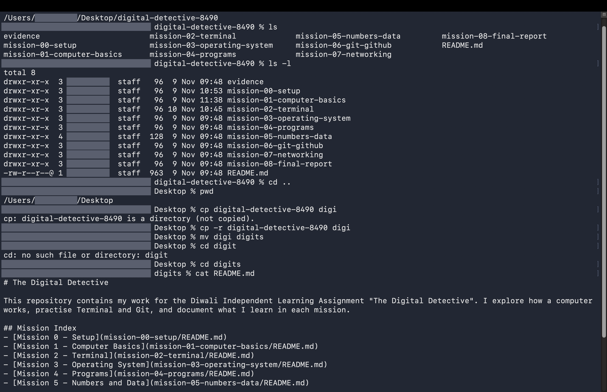

# Mission 2 - Terminal

## Work completed

### Basic Terminal operations
| Operation | Command | What it does | What I observed |
|---|---|---|---|
| Current-directory display | pwd | Prints the full path of the folder I'm in | It printed a long path ending in the project folder name |
| Directory listing | ls | Lists the files and folders here | I saw the mission folders and README.md in a plain list |
| Detailed listing | ls -l | Lists items with permissions, owner, size and date | Each item took its own line with extra columns |
| Change directory | cd .. | Moves up to the parent folder | pwd afterwards showed a shorter path |
| Create directory | mkdir demo-folder | Creates a new folder | ls then showed demo-folder |
| Create empty file | touch demo-folder/act.txt | Creates an empty file | The file appeared in the folder with size 0 |
| Copy file | cp demo-folder/act.txt demo-folder/slop.txt | Duplicates a file under a new name | Both act.txt and slop.txt were listed |
| Move or rename file | mv demo-folder/slop.txt demo-folder/roam.txt | Renames or relocates a file | slop.txt was gone and roam.txt took its place |
| Display file contents | cat demo-folder/act.txt | Prints a file's contents | Nothing printed, because the file was empty |

### Practice inside terminal-practice
Replacing contents vs adding to the end:
For replacing I used echo > detination whereas for adding instead of '>' we'll use '>>'. 

Copying vs moving a file:
for copying the files, the command used is cp and for the moving the files it is mv comand. 

### Flags and pipes
Normal listing vs detailed listing:
ls only shows the names of the files and folders. ls -l shows one item per line with the permissions, owner, size and date.

Comparing ls -l and ls -lah:
ls -lah shows everything that ls -l shows, but with two more things. The a flag shows hidden files too, the ones that start with a dot. I could see .git and .DS_Store, which ls -l did not show. The h flag makes the sizes easy to read, like 2.2K instead of 2228.

What the pipe symbol does:
It sends the previous output as an input for the second in the piping.

### Package managers
Command: brew --version
Output: Homebrew 7.0.12

Command: brew list
Output: A list of 27 packages that are installed with Homebrew on my Mac. For example git, ffmpeg, uv and cowsay.

What a package manager is and why it is useful:
A package manager is a tool that installs, updates and removes software from the Terminal with one command. I don't have to search for a website, download a file and install it by clicking. It also installs the other things the software needs, and it keeps a list of what is installed. Homebrew is the package manager I used on my Mac.

## Commands used

These are the commands I used in this mission: pwd, ls, ls -l, ls -lah, cd, mkdir, touch, cp, mv, cat, brew --version, brew list. 

## My understanding

I got that how to use this commands, and how they work and useful in our daily tasks and project we're working on. It's been so fresh to revise the basic commands.

## Difficulties faced

Everyhting went smooth, no onstacles occured in between the progress.

## How I resolved them
Not applicable

## Evidence

## Commit details

The commint message was Complete Terminal and file management mission,  and successfully pushed to the Github repo.

