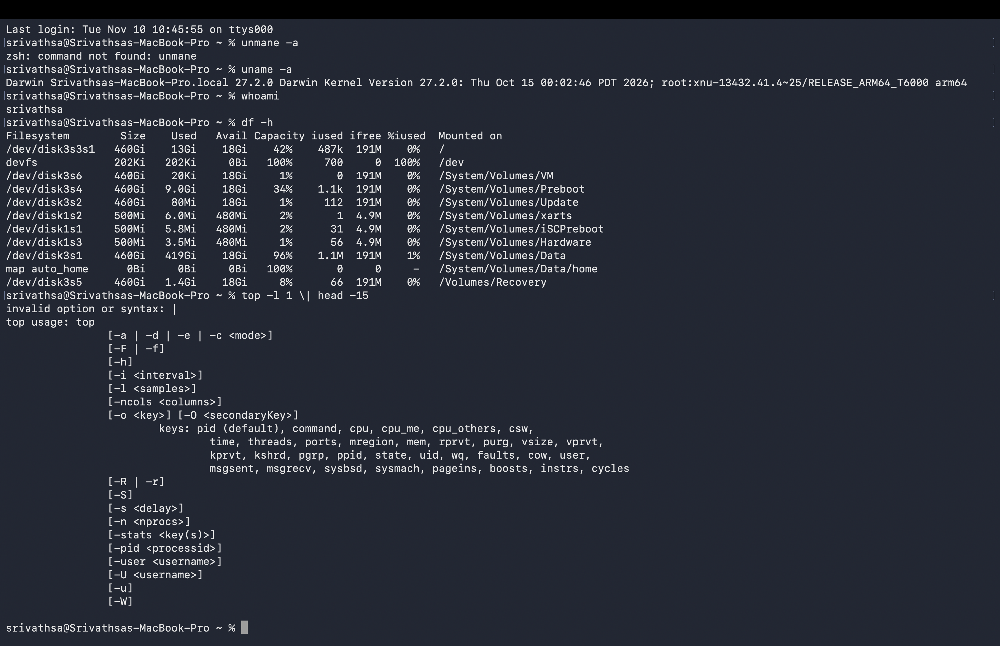

# Mission 3 - Operating System

## Work completed

### Exploring the operating system
| Information explored | Command | What it tells me | My observation (privacy-safe) |
|---|---|---|---|
| Operating system details | `uname -a` | Which OS and kernel is running, and the machine type | It printed Darwin, then a version number, then the chip type. The device name was Srivathsas-MacBook-Pro.local |
| Current account identity | `whoami` | The name of the account I'm logged in as | It printed my account name, srivathsa |
| Available and used storage | `df -h` | How much disk space is used and how much is free, in readable sizes | The main disk showed about half used and about half free |
| System activity snapshot | `top -l 1 \| head -15` | A quick look at CPU use, memory use and running processes | The top lines showed CPU and memory usage and a list of busy processes |

### Processes

A process is a program that is running right now.

The PID is the unique number the OS gives each process so it can be identified.

Two examples of processes on my computer:
Finder and Terminal.

### Paths and permissions
Absolute path vs relative path, with one example of each from my folder:
- Absolute path starts from the root `/`: `/Users/srivathsa/Desktop/digital-detective-8490/mission-03-operating-system/README.md`
- Relative path starts from the current folder: `mission-03-operating-system/README.md`

Permissions of one file in my practice area (owner can read, write, execute?):
README.md shows `-rw-r--r--`. The owner can read and write but cannot execute.

### Operating system responsibilities
| Responsibility | My explanation | Example |
|---|---|---|
| Process management | Starts, stops and schedules running programs. | `top` shows many processes running together. |
| Memory management | Gives RAM to programs and takes it back after. | Memory usage shown in `top`. |
| Device management | Lets programs use hardware like keyboard and screen. | Typing in Terminal appears on screen. |
| File management | Stores and organises files and folders. | `df -h` shows disk space. |
| User interface or shell | Lets me interact with the computer. | I used the zsh shell in Terminal. |
| Security and permissions | Controls who can access or change things. | `whoami` and `ls -l` permissions. |

## Commands used
- `uname -a`
- `whoami`
- `df -h`
- `top -l 1 | head -15`
- `ls -l`

## My understanding
The OS manages processes, memory, devices, files and security so the computer works smoothly. These commands let me see it in action.

## Difficulties faced

I encountered the new commands such as df, uname, and explored about their properties and functions. In the first it's difficult to read the output after this new commands.

## How I resolved them

I researched and talked with my friends how exactly this commands and why we're using in our daily work life. I used the help of google and ai to explore the not known parts.

## Evidence

## Commit details

