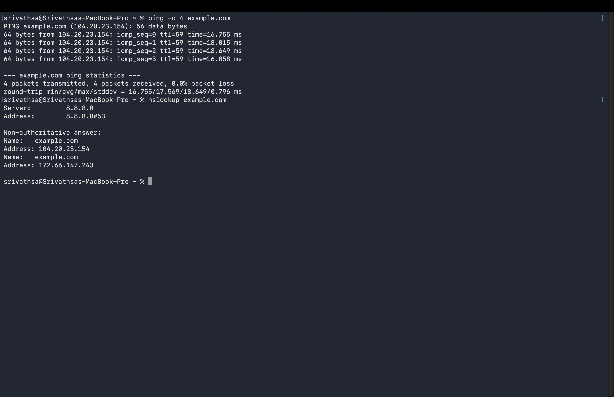

# Mission 7 - Networking

## Work completed

### Network concepts
| Concept | In my own words | Example |
|---|---|---|
| LAN | A network in a small area, owned by one person or group. | Wifi at my home |
| MAN | A network that covers a city. | Colleges in one city connected together |
| WAN | A network that covers a very large area. The internet is the biggest one. | The internet |
| DNS | Changes a website name into an IP address, so we don't have to remember numbers. | example.com becomes 104.20.23.154 |
| Router | Connects networks and sends data to the right place. | The wifi box at home |
| Protocol | Rules that devices follow so they understand each other. | HTTPS |
| Packet switching | A big message is cut into small packets. They are sent separately and put back together at the end. | Sending a large file |
| Client-server | The client asks for something and the server answers. | My browser and a website |

### Network observations
Connectivity test: ping -c 4 example.com

What I observed: 4 packets were sent and 4 came back, with 0% loss. Each reply took about 17 ms.

What a connectivity test helps me check:
If my computer can reach another machine, and how fast it replies.

DNS lookup: nslookup example.com

What I observed: The DNS server was 8.8.8.8. This is Google's public DNS server, so it is not a private detail. It gave two addresses for example.com.

What a DNS lookup displays:
It shows the IP address of a website name.

The role of DNS when I type a website name in a browser:
The browser needs the IP address before it can contact the server. DNS gives it that address.

### What happens when I open a website
1. I type the address in my browser. The browser is the client.
2. The browser asks DNS for the IP address of the name.
3. The request goes through my router and the network, using a protocol like HTTPS.
4. The server receives the request.
5. The server sends back the page.
6. My browser shows the page.

## Commands used
- ping -c 4 example.com: tests whether my computer can reach a public website
- nslookup example.com: looks up the address linked to a domain name
- git add, git commit, git push: saved and published the work

## My understanding
When I open a website, the browser first asks DNS for the IP address. Then it sends a request through my router and the internet to the server. The server sends the page back and the browser shows it. If DNS stopped working, I could not open sites by name because the browser would not know the address.

## Difficulties faced
I did not understand the ping command at first. I forgot some concepts like WAN and mixed up LAN, MAN and WAN. All the commands were new to me, so I was not sure what the output meant.

## How I resolved them
I took help from AI, my friend and my seniors. They explained the commands and the difference between LAN, MAN and WAN. I also ran the commands myself to understand the output.

## Evidence

## Commit details
Commit message: Explain networking concepts and website communication. Pushed to GitHub.
